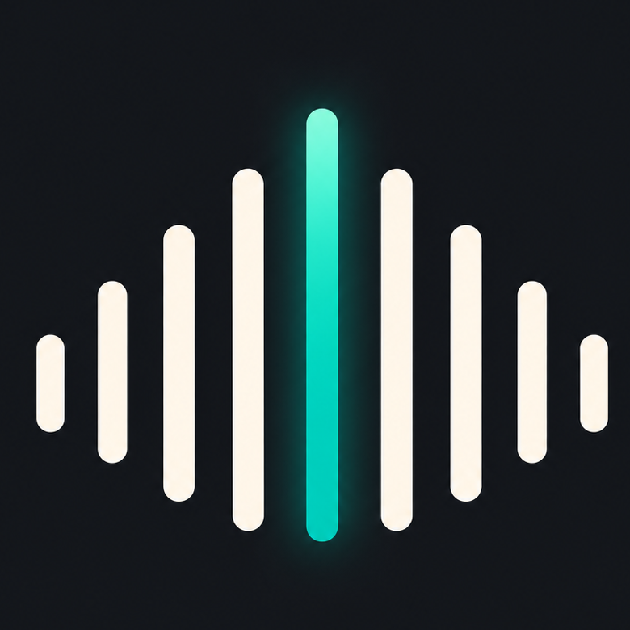
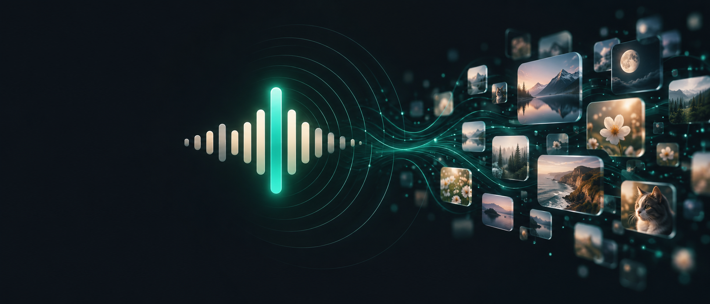
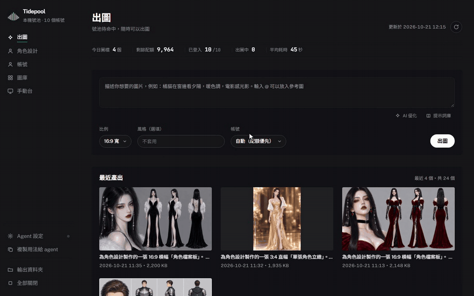
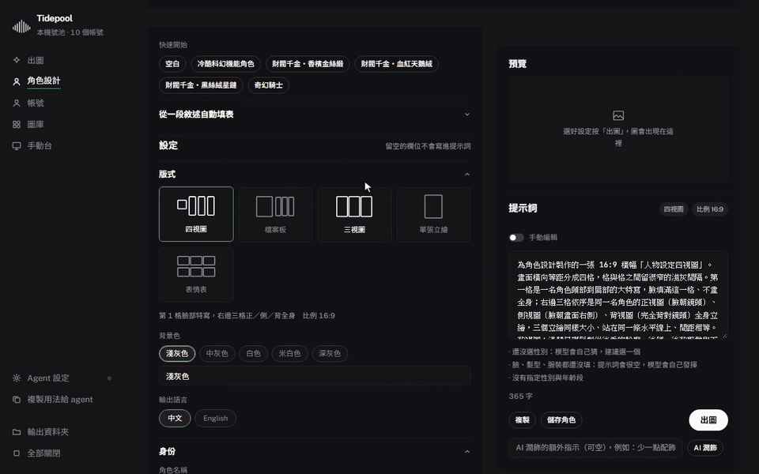
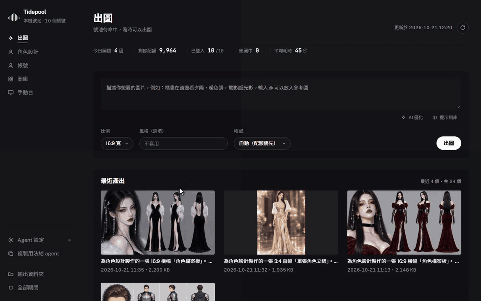
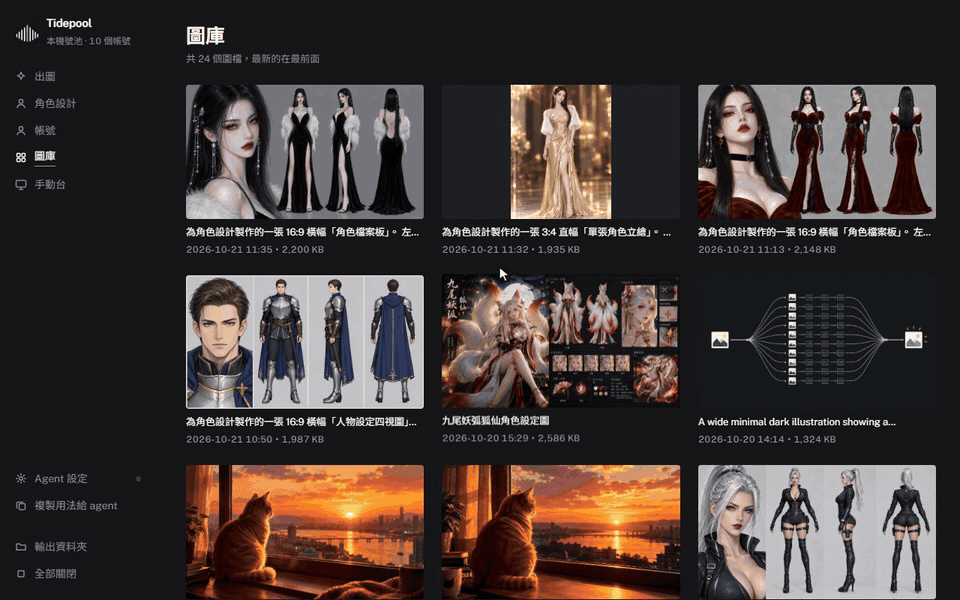

<div align="center">

<p><a href="README.md">繁體中文</a> · <a href="README.en.md">English</a></p>



# Tidepool

**Use every bit of the ChatGPT web quota you already pay for.**

Queue, parallelize, auto-login and call it from agents. All on your own machine, no API key.

[](https://www.python.org/)
[](#quick-start)
[](LICENSE)
[](#for-agents)

</div>

<p align="center">
  
</p>

---

## Why Tidepool

Every ChatGPT web account has an image quota, but you can only spend it by hand, one image at a time.
Tidepool turns **the quota you already pay for** into a schedulable local service:

- **Spend the whole quota**: each account runs in its own isolated browser profile; jobs are spread by remaining quota and run in parallel
- **No API key, no API bill**: it drives the web app itself; login, Turnstile and 2FA are handled for you
- **For people and agents**: web console, NewAPI-compatible endpoints, a one-line CLI
- **Local only**: bound to `127.0.0.1`; images never pass through a third party
- **Silent**: browsers and CLIs run in the background, no windows, no focus stealing

> How you obtain and manage multiple accounts is out of scope. Follow ChatGPT's terms and use only your own accounts.

## See it in action

### Generate, with AI optimize

Write a rough idea, let an agent on your machine rewrite it into a proper prompt, then generate. Style and ratio are optional.



### Character designer

Pick layout, identity, outfit and style from menus and the prompt is assembled live; or paste a description and let AI fill the form.
Finished images land in the page's character assets, and one click reuses an image as a reference for a new outfit.



### Agent settings: auto-detect, connect one by one

Opening the dialog scans local agent CLIs and their models; without a CLI, add an API key.
Every entry can be tested or removed, and you can add any OpenAI-compatible provider.



### Gallery

Everything in one place; portrait and landscape images both show whole. Click for the full view with its original prompt.



> Waiting time for AI replies is cut from the clips (a real AI optimize takes about 10 s).
> Recorded by driving the real console with [onetake](https://github.com/feitangyuan/onetake)'s recording script.
> Script: [`demo/footage.json`](demo/footage.json); how to rebuild: [`demo/README.md`](demo/README.md).

## Features

| | |
| --- | --- |
| **Generate** | Queue, parallel, quota-aware account choice; `@Image1` references are attached to ChatGPT automatically |
| **Character designer** | 30 fields, ~1,200 terms to pick or type; four-view / profile board / three-view / portrait / expression sheet; AI analyze and polish; character assets |
| **AI optimize** | Uses your installed Codex / Claude Code / OpenCode / Antigravity CLI, or any OpenAI-compatible API |
| **Manual bench** | Embed an account's ChatGPT page in the console: type, upload references, send |
| **Assets & prompt library** | Reference-image assets; 541 cases from [awesome-gpt-image-2](https://github.com/freestylefly/awesome-gpt-image-2) |
| **Accounts** | Status, remaining quota, one-click 2FA copy, import, re-login all |
| **For agents** | `/v1/videos` + `/v1/tasks` (NewAPI-compatible), CLI, bundled skill |

## Quick start

### Fresh Windows machine

1. Install **Python 3.10+** (tick "Add Python to PATH") and **Google Chrome**.
2. Get the code and set up the environment:

```powershell
git clone https://github.com/ayase0307/tidepool.git
cd tidepool
python -m venv venv
venv\Scripts\pip install -U pip
venv\Scripts\pip install -r requirements.txt
venv\Scripts\python -m patchright install chromium
```

3. Create `secrets\accounts.txt`, one account per line (see [format](#account-file-format)):

```
you@example.com----your-password----BASE32 2FA SECRET
```

4. Start: `start apps\start_service.vbs`, then open <http://127.0.0.1:7707/panel>.

<details>
<summary>macOS / Linux</summary>

```bash
git clone https://github.com/ayase0307/tidepool.git && cd tidepool
python3 -m venv venv && source venv/bin/activate
pip install -U pip && pip install -r requirements.txt
python -m patchright install chromium
python core/pool_service.py
```
</details>

## For agents

```bash
curl -X POST http://127.0.0.1:7707/v1/videos \
  -H "Authorization: Bearer aipool-local" -H "Content-Type: application/json" \
  -d '{"model":"gpt-image2-1k","prompt":"a shiba inu running on grass, sunlight","aspect_ratio":"16:9"}'
# -> {"id":"<task_id>","status":"queued"}

curl http://127.0.0.1:7707/v1/tasks/<task_id> -H "Authorization: Bearer aipool-local"
# -> {"status":"completed","result":{"urls":["http://127.0.0.1:7707/api/outputs/file/xxx.png"]}}
```

CLI: `venv\Scripts\python core\generate.py "prompt" -o out.png -w 3`. A bundled `chatgpt-image-gen` skill wraps the same API;
the console's "copy usage for agent" button copies the instructions.

## Agent settings

Bottom-left **Agent settings** lists providers that power "AI optimize" and the character designer. Each provider auto-detects its own models; every entry can be removed (built-ins can be restored).

| Tab | What | Credentials |
| --- | --- | --- |
| Local CLI | Scans PATH for Codex / Claude Code / OpenCode / Antigravity CLIs; runs silently | each CLI's `login` |
| API key | OpenAI, OpenCode Go, Command Code, or any OpenAI-compatible service you add | yours |

## Character designer

The **Character** page keeps your character assets on top, settings on the left, and the preview + prompt + generate button on the right.
It has layouts, 30 pick-or-type fields, live prompt assembly following the "character sheet" rules (even flat light, solid background, everything sharp, gender and age repeated per view, traits pinned one by one), AI analyze from a pasted description, AI polish with undo, and one-click "restyle from this image".
The lexicon and four-view rules come from [Character-Prompt-Studio](https://github.com/joshesye/Character-Prompt-Studio) (MIT, based on ai-image-prompt by AI绘梦師葉子); see [`core/character/NOTICE.md`](core/character/NOTICE.md).

## Architecture

One Python process: `:9000` VirtualBrowser-compatible shim, `:7707` admin API + console, and N patchright browser workers (own profile, UA, canvas/WebGL noise fingerprint; CDP port 9300 + i).
Generation drives the page directly and fetches the image in-page as base64; windows are hidden the instant they open and CLI children are always hidden.

## Account file format

`secrets\accounts.txt`: `email----password----BASE32 2FA SECRET`, one per line, `#` for comments. The console's import button backs up the old file as `accounts.txt.bak`.

## Notes

- Each account has **999 images** of quota; wait for the reset when it runs out
- Everything binds to `127.0.0.1`; change the built-in `/v1/*` local keys before exposing it
- `secrets/`, `data/` and `output/` are git-ignored

## Credits

[awesome-gpt-image-2](https://github.com/freestylefly/awesome-gpt-image-2) · [Character-Prompt-Studio](https://github.com/joshesye/Character-Prompt-Studio) (MIT) · [onetake](https://github.com/feitangyuan/onetake) (recording script for the demos)

## License

MIT © Tidepool
